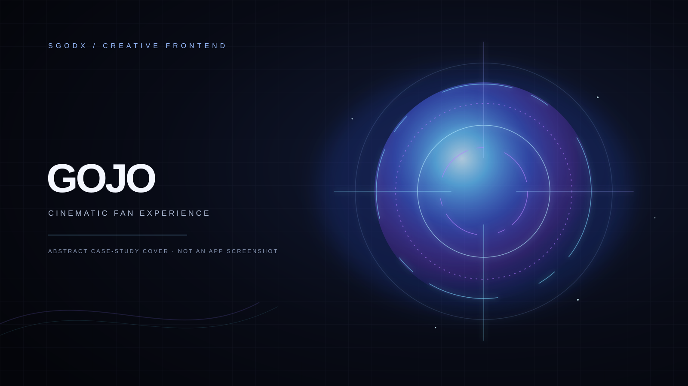

SGODX / CREATIVE FRONTEND CASE STUDY

# Gojo SGODX

**A cinematic, interactive fan experience shaped around Satoru Gojo.**

[Open the live experience](https://gojo-sgodx.vercel.app/) · [View the case study](https://dpsychoo.github.io/gojo-sgodx-showcase/) · [SGODX / dpsychoo](https://github.com/dpsychoo)

Presentation-only repository · Production implementation and unverified media are not included

## 1. Project overview

Gojo SGODX is an unofficial, five-scene browser experience inspired by Satoru Gojo and the visual language of *Jujutsu Kaisen*. It combines cinematic scene changes with custom interaction and motion work. The live project is an adaptation of a pre-existing HTML experience; its original author and source repository have not been verified. SGODX's documented contribution is the subsequent customization and technical work, not authorship of the entire inherited base.

This repository is a public portfolio case study. It contains no production source, private project files, shaders, character images, video, or production screenshots.

## 2. Live demo

[Explore Gojo SGODX on Vercel](https://gojo-sgodx.vercel.app/)

The demo is hosted separately. The live site's availability and contents are controlled by its deployment; this repository does not reproduce or redistribute its media.

## 3. Visual preview

The cover above is original abstract artwork created for this case study. It is deliberately not presented as an application capture. Real desktop and mobile captures were reviewed privately but are withheld because redistribution permission for the Jujutsu Kaisen imagery and video shown in them has not been confirmed. See the [screenshot inventory](assets/screenshots/README.md).

## 4. Key features

- Five navigable cinematic scenes with next, previous, and scene-selection controls.
- A branded preloader and scene-entry motion.
- A Six Eyes pointer treatment with a fluid energy trail on supported devices.
- Interactive Limitless and Six Eyes cards.
- Silent, optimized scene video and responsive image variants in the live experience.
- A sound control using browser audio synthesis.
- Reduced-motion and non-WebGL fallbacks in the production experience.

These describe the separately hosted application, not code shipped in this case-study repository.

## 5. Verified technology stack

The production project has been inspected and records the following actual technologies and assets:

| Area | Technology |
| --- | --- |
| Markup and presentation | HTML5 and CSS |
| Application behavior | Vanilla JavaScript |
| Scene motion | GSAP 3.15.0, loaded from a pinned CDN URL with Subresource Integrity |
| Visual effects | Canvas, WebGL and GLSL shaders |
| Sound interaction | Web Audio API oscillators; no bundled audio samples |
| Local media | WebP images and silent H.264 MP4 video |
| Browser tests | Playwright Test 1.64.1 (development only) |

No React, Three.js, bundler, or new effects library is part of the verified production stack. This showcase page itself uses plain HTML, CSS, SVG and system fonts, with no runtime dependency.

## 6. UI/UX and creative development

The experience uses deep blue and violet tones, luminous focal effects, motion-led transitions, and scene controls to make the navigation feel like a sequence rather than a conventional content page. The pointer treatment and card interactions give the interface responsive visual feedback. Touch and reduced-motion paths are supported by the production experience.

## 7. Engineering highlights

- Five scene states share a single navigation model.
- Video and image formats were optimized in the production project.
- Preloader initialization includes a timed fallback when GSAP is unavailable.
- Pointer rendering has a fallback for environments without WebGL.
- Browser coverage is maintained with Playwright in the private source project.

This showcase makes no new benchmark or cross-platform test claim. Its purpose is to describe verified project capabilities while keeping unresolved source and media out of the public package.

## 8. Responsive experience

The deployed experience includes layouts and controls intended for desktop and touch viewports. The source project has been exercised at desktop and mobile viewport sizes in its Playwright suite. No interface screenshot is included here until its depicted third-party material is cleared for redistribution.

## 9. Credits and disclaimer

Satoru Gojo and *Jujutsu Kaisen* are the property of their respective rights holders. This is an unofficial fan experience and is not affiliated with, sponsored by, or endorsed by the rights holders. No rights to characters, marks, images, or footage are claimed or granted by this repository.

The deployed application adapts an inherited HTML base whose author, source URL, and distribution terms remain unverified. A cursor fragment in the private production project also has unresolved upstream provenance and is not included here. See [NOTICE.md](NOTICE.md) for the scope and distribution limits of this case study.

## 10. SGODX / dpsychoo

Created and customized for the SGODX portfolio by [David Castro / dpsychoo](https://github.com/dpsychoo). The description distinguishes SGODX's project work from the unverified authorship of the inherited base and third-party media.

---

**Repository scope:** presentation material only. No general reuse license is offered while ownership and permissions for the inherited production work remain unresolved.
